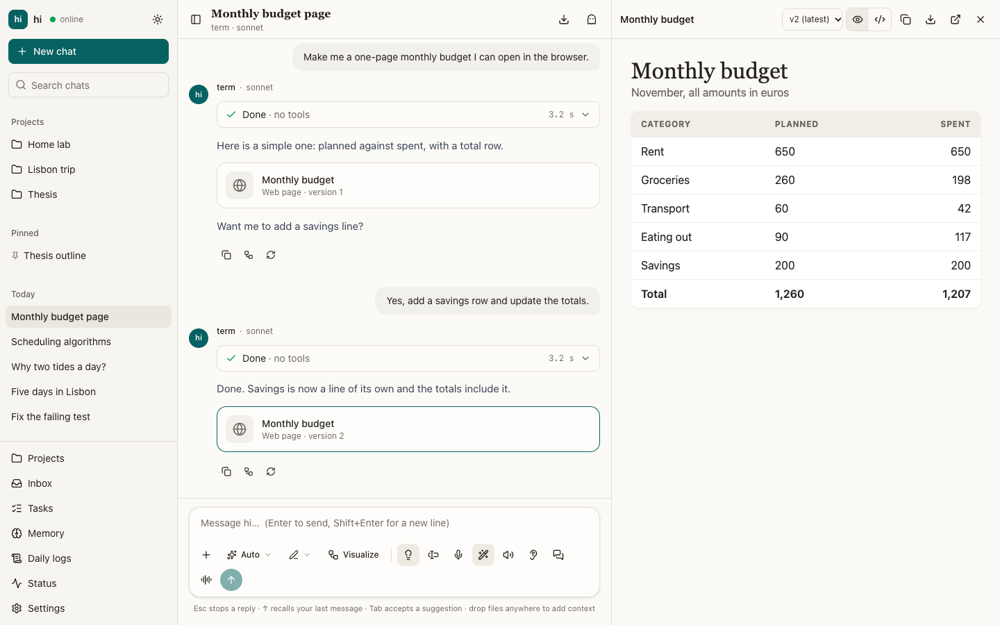
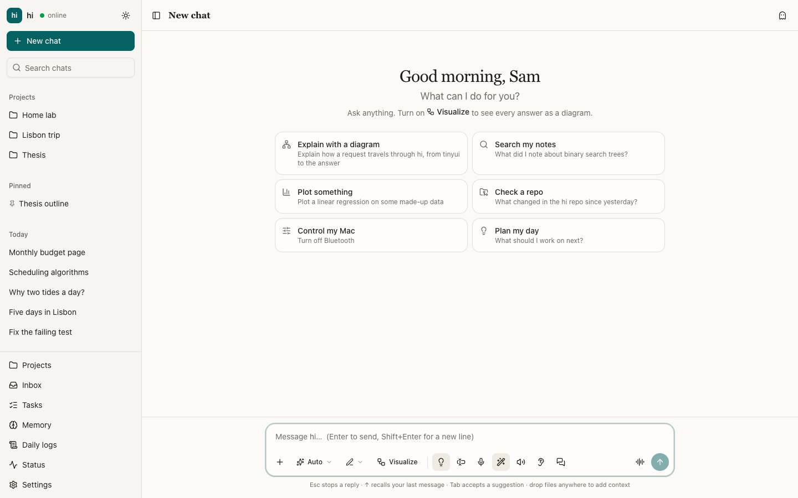
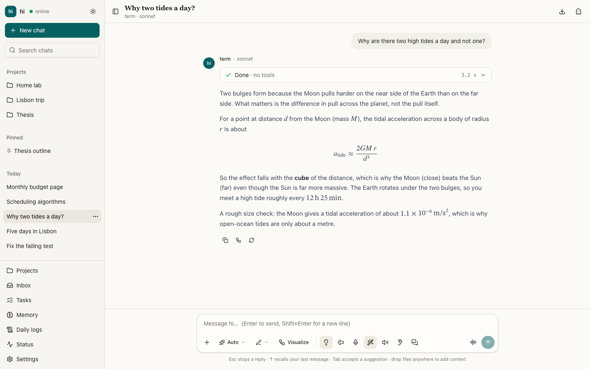
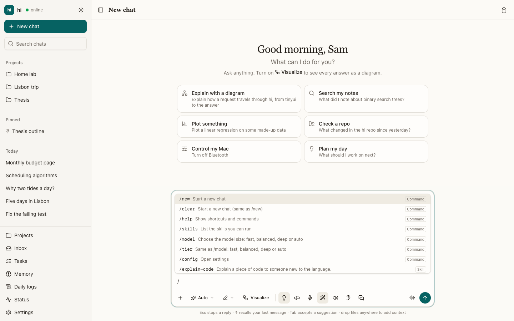
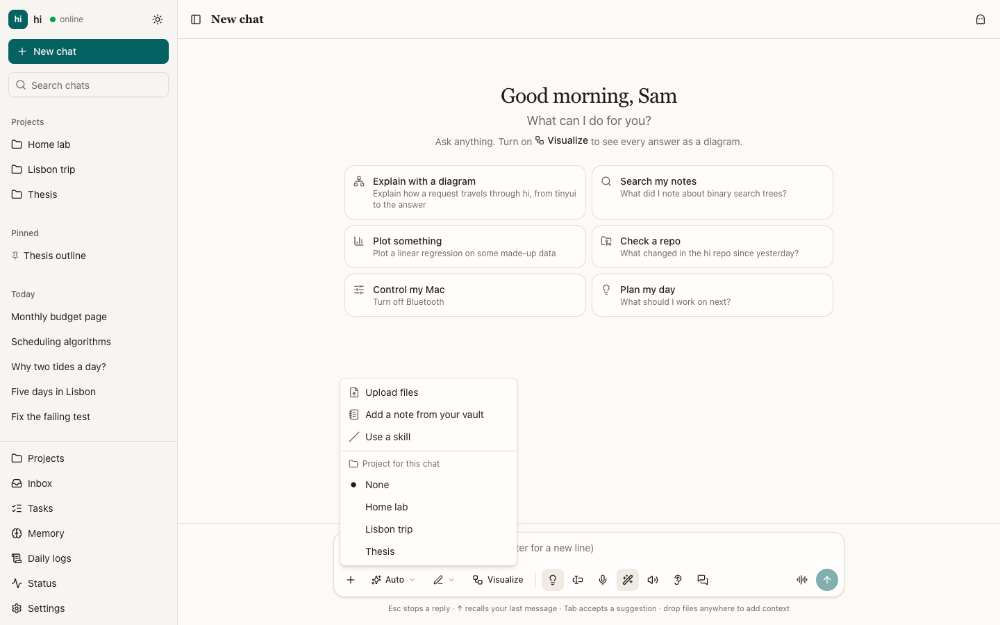
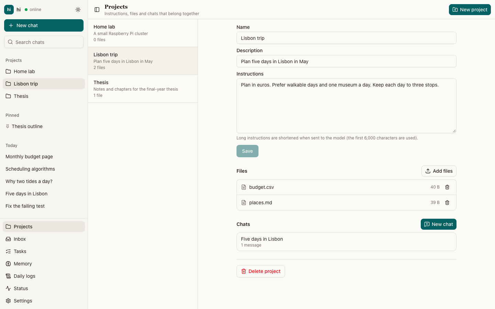
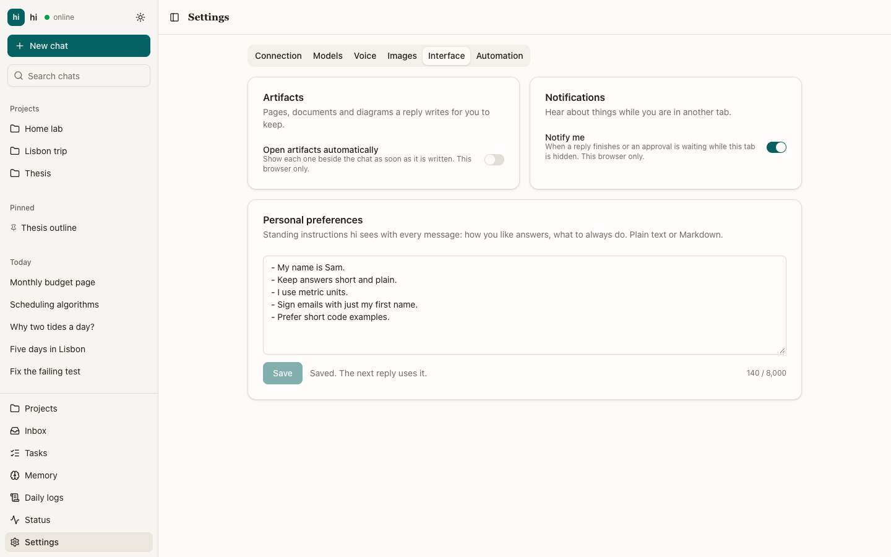
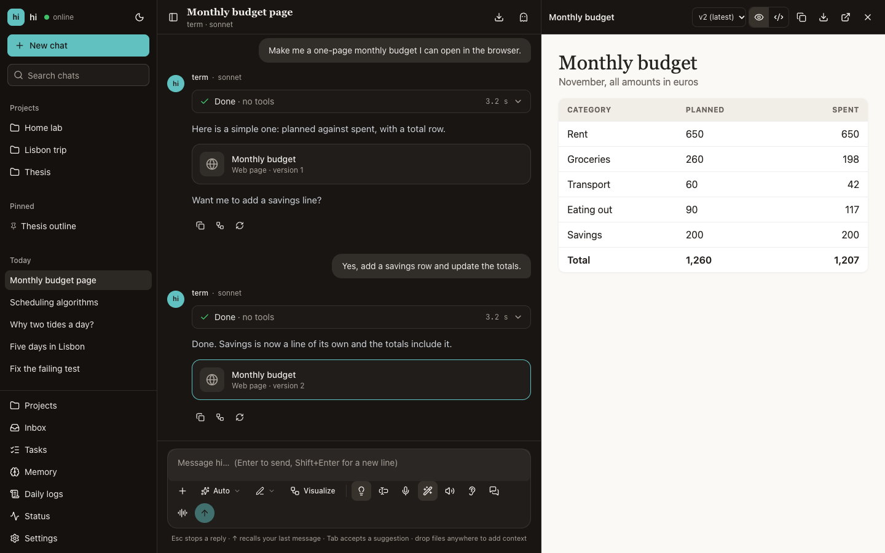
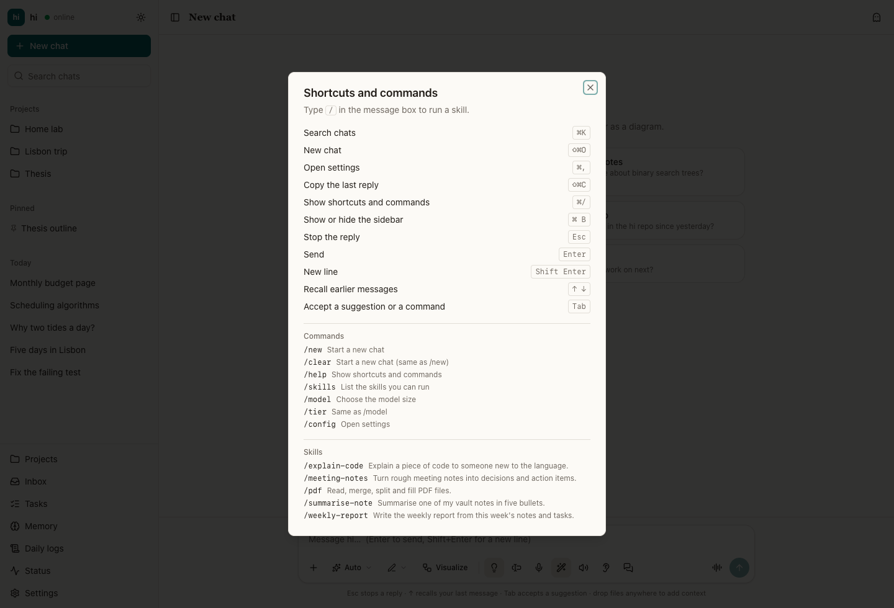
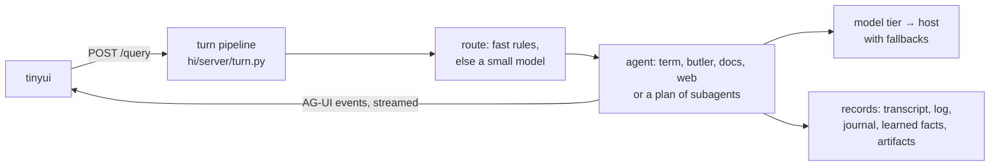

<div align="center">


### A personal assistant that runs on your own models and remembers in plain files.

Chat, projects, artifacts and skills in a web app. Everything `hi` remembers is a Markdown or JSONL file in your Obsidian vault: no vector database, no hidden state.


</div>

---



_A reply made a web page. It is a card in the chat, saved in the vault as versions, and opened in a panel beside the conversation._

## What it is

- **The filesystem is the only memory.** Notes, chats, projects, artifacts and skills are files under your vault. You can open, edit or delete any of them in Obsidian. The model stores nothing itself.
- **Your models, your machine.** `hi` talks to [Ollama](https://ollama.com): on this computer, or on another machine over [Tailscale](https://tailscale.com). It picks a model size for each message and falls back to a smaller one, or the other machine, when something is down.
- **One interface.** `tinyui` (a Vue app) talks to a Starlette backend. The terminal UI and per-persona flags of earlier versions are gone.
- **It asks before it acts.** A background run can read and write reports. Anything else becomes a proposal that waits for your approval.

## A tour of tinyui

<table>
<tr>
<td width="50%"></td>
<td width="50%"></td>
</tr>
<tr>
<td><b>A calm start.</b> A time-of-day greeting (it uses the first name from your preferences), your projects and chats on the left, one box to type in.</td>
<td><b>Math, diagrams and code.</b> Replies render KaTeX, Mermaid diagrams, 3D scenes and code blocks with a copy button.</td>
</tr>
<tr>
<td width="50%"></td>
<td width="50%"></td>
</tr>
<tr>
<td><b>Type <code>/</code>.</b> Built-in commands first (<code>/new</code>, <code>/model</code>, <code>/help</code>, ...), then your skills. <code>/weekly-report this week</code> runs that skill for one message.</td>
<td><b>The <code>+</code> menu.</b> Upload files, add one of your vault notes as context, start a skill, or put the chat in a project.</td>
</tr>
<tr>
<td width="50%"></td>
<td width="50%"></td>
</tr>
<tr>
<td><b>Projects.</b> A project keeps instructions, files and chats together. Every chat in it starts with the instructions and can open the files.</td>
<td><b>Your preferences.</b> Standing instructions that go with every message, edited in Settings and stored in <code>hi/knowledge/preferences.md</code>.</td>
</tr>
<tr>
<td width="50%"></td>
<td width="50%"></td>
</tr>
<tr>
<td><b>Light and dark.</b> Both are first class; the theme follows your system or the toggle in the sidebar.</td>
<td><b>Keyboard first.</b> <code>⌘K</code> search, <code>⇧⌘O</code> new chat, <code>⌘/</code> this sheet. <code>Tab</code> accepts a suggestion.</td>
</tr>
</table>

### What you can do in a chat

| | |
|---|---|
| **Edit and try again** | Edit any of your messages, or ask again on any reply. Nothing is deleted: the chat is a tree, and a `‹ 2/3 ›` switcher moves between attempts. |
| **Type ahead** | Press Enter while a reply streams and the message waits and goes out when it ends. |
| **Artifacts** | A reply can make a page, SVG, document, diagram or longer code. Each is saved as versions in the vault; HTML and SVG run in a sandboxed frame. The newest version goes back to the model, so "make the title bigger" edits the real page. |
| **Writing styles** | Normal, Concise, Explanatory, Formal, and your own: a note in `hi/styles/` with the instruction. |
| **Think on or off** | Stream the model's reasoning before the answer, or turn it off for faster replies. Disabled when the model cannot think. |
| **Suggestions** | Grey text after your cursor, from your earlier messages first and a fast model second. `Tab` accepts. |
| **Context ring** | Shows how full the model's context window is. Earlier turns that no longer fit are folded into a running summary so the chat still knows what was decided. |
| **Incognito** | A ghost button starts a chat that is not listed, not logged, not learned from, and deleted when you leave it. |
| **Export and notify** | Download a chat as Markdown. Get a browser notification when a reply finishes or an approval is waiting while the tab is hidden. |

## Quick start

You need [`uv`](https://docs.astral.sh/uv/), [Docker](https://www.docker.com/) and [Ollama](https://ollama.com) with the models for your setup (see [Models](#models)).

```bash
git clone <this repo>
cd hi
uv sync
uv tool install --editable .     # puts `hi` on your PATH
hi                               # starts the stack and opens tinyui
```

`hi` runs `docker compose up -d --build` when the backend is not already answering, then opens tinyui at <http://localhost:5173>. The backend listens on `127.0.0.1:8765`, loopback only.

Without Docker, run the two halves yourself:

```bash
hi --voice-daemon                # the backend, natively, on :8765
cd tinyui && npm install && npm run dev   # tinyui on :5173
```

Notes:

- Set `HI_VAULT=/path/to/your/vault` in a `.env` next to `docker-compose.yml` to use your real notes. Otherwise the container keeps its own vault in a Docker volume. Set `HI_WEB_PORT` if 5173 is taken.
- The Docker image is Linux. Shell, notes, files, web, documents and orchestration work there; macOS control (Bluetooth, volume, screen) and the menu bar app need `hi` run natively on the Mac.
- On Windows, install Docker Desktop and Git, then run `uv sync` and `uv run hi`. Mac-only tools do not apply.
- `tinyui` allows one origin to call the backend (`localhost:5173`). A different dev port needs `HI_CORS_ORIGINS`.

## Models

`hi` has two modes, switched in **Settings → Connection** (or `AI_MODE`):

| Mode | Where the models run |
|---|---|
| `local` | Ollama on this machine (from Docker, through `host.docker.internal`) |
| `tailscale` | Ollama on another machine over your tailnet (`TAILSCALE_OLLAMA_URL`) |

Each mode remembers its own model names. You choose how much model to spend; `hi` still decides what kind of help a message needs:

| Size in the app | Tier | `local` default | `tailscale` default |
|---|---|---|---|
| Auto | the router picks per message | | |
| Fast | haiku | `gpt-oss:20b-cloud` | `gemma4:e4b` |
| Balanced | sonnet | `gpt-oss:120b-cloud` | `gemma4:e4b` |
| Deep | opus | `nemotron-3-ultra:cloud` | `gpt-oss:20b` |

If a tier's model is missing, the next cheaper one is used (a local model is pulled in the background). If a host is unreachable, the other configured host is tried. Change any of this in Settings → Models; it applies immediately.

**Context window.** `CONTEXT_TOKENS` (default 16384, in Settings or `~/.hi/.env`) is sent to Ollama as `num_ctx`. A larger window costs memory on the Ollama host, so raise it only where there is room.

## Where things live

Everything `hi` remembers is under `<VAULT_PATH>/hi/` (and your skills under `<VAULT_PATH>/skills/`):

```text
<vault>/
├── skills/<name>/SKILL.md      skills: instructions you run with /name (any depth works)
└── hi/
    ├── knowledge/              notes, preferences.md, people/
    ├── sessions/               one note per chat (title, head, project, summary)
    ├── transcripts/            every turn as JSONL, as a tree (id and parent)
    ├── conversations/          one readable Markdown log per day
    ├── journal/                the day's activity
    ├── artifacts/<chat>/<slug>/v1.html ...   artifact versions
    ├── projects/<slug>/PROJECT.md + files    projects
    ├── styles/                 your writing styles
    ├── tasks/  reports/  schedules/  drop/  heartbeat/   background work
    └── backups/                the old copy of anything hi replaces
```

Every note carries Obsidian-compatible frontmatter (`tags: [hi, ...]`), so the vault's own search finds them. `hi`'s settings live in `~/.hi/` (`.env`, `dev_flows.json`).

## How a message is answered



- **Personas.** `term` is the general assistant (shell, notes, files, dev work, memory); `butler` controls the Mac; `docs` answers only from your notes and cites them; `web` searches and summarises. The router picks one per message.
- **Plans.** A multi-part request is split into a DAG of scoped subagents; independent tasks run in parallel, each with only the tools its task needs. Every run leaves a trace note.
- **Memory is read, not stored.** Before answering, `hi` pulls in relevant vault notes. After an answered turn it may write down a durable fact, unless the chat is incognito.
- **Failures are visible.** `GET /health` shows each dependency, each background job's last run and how fast turns have been.

The package map and the rules about who may import whom are in [docs/architecture.md](docs/architecture.md).

## Skills

A skill is a folder with a `SKILL.md` (name and description in the frontmatter, instructions in the body) anywhere under `<vault>/skills/`. A cloned skills repository works as it is. The model sees a one-line index and loads one with `use_skill`; in the app, `/name your request` loads it for that message. `hi` can write skills too (`create_skill`, `update_skill`); updating asks first and keeps the old file in `hi/backups/`. Add `invoke: false` to hide a skill from `/`.

## Work it does without being asked

Schedules ("every weekday at 8"), a heartbeat that looks at what is due and on your screen, and a drop folder (save a file into `hi/drop/` and it is read, filed and its tasks added). They read freely and write reports; anything else is a proposal in **Inbox → Actions** with the exact arguments and Approve and Deny. Limits, secrets masking and the details are in [docs/automation.md](docs/automation.md).

## Tools and integrations

| | |
|---|---|
| **Mac control** | Bluetooth, volume, Wi-Fi, Do Not Disturb, screenshots, clipboard, apps and windows, through a host bridge (macOS only). |
| **Code and data** | A sandbox container runs Python for charts and file processing; plots and files come back to the chat. |
| **Web** | SearXNG for search, Wikipedia, and real browsing through the Playwright MCP server. |
| **Images and 3D** | Image generation (a local service, or the tailscale machine in that mode) and 3D scenes drawn with three.js. |
| **Voice** | Local speech to text (Whisper) and text to speech (Ollama's `phonon`, or a GPU service). `hi --wake-daemon` listens for "Hey Jarvis". If the TTS engine is down, `hi` stays silent; it never switches voices. |
| **Menu bar** | `hi --menubar` adds a global hotkey and a prompt that can use your screen as context. `hi --install-agent` starts it at login. |
| **MCP servers** | Playwright is on by default. GitHub, Obsidian (Local REST API plugin) and n8n turn on once you add their credentials in `~/.hi/.env`. A server that is not configured is simply absent. |
| **Google** | Drive, Docs, Sheets, Slides, Gmail, Calendar and Tasks through a separate service you authorise yourself. |

Screen and tab reading is on request only, never a background watcher, and it refuses near a password manager or a private window.

## Project layout

```text
hi/core/          health registry, fallback helper, background jobs
hi/llm/           providers (local + tailscale Ollama), tier registry, reasoning probe, retry
hi/memory/        the vault: sessions, transcript, artifacts, projects, skills, summary, journal, extraction
hi/agents/        agent factory and the personas: term, butler, docs, web
hi/orchestrator/  multi-step plans run as a DAG of scoped subagents
hi/automation/    scheduler, heartbeat, drop folder, delivery, limits
hi/server/        Starlette app: routes/ (one module per area), turn.py (one query end to end)
hi/cli.py         the `hi` launcher and daemon flags
tinyui/           the web UI (Vue 3, Tailwind, shadcn-vue)
tests/unit/       unit tests: no network, no real vault
```

Layers, lowest to highest: `core` → `llm` → `memory` → `agents`, `orchestrator`, `automation` → `server`, `cli`. A lower layer never imports a higher one, and `tests/unit/test_layering.py` checks it.

## HTTP API

The backend serves JSON and one event stream. The main routes:

| Route | What |
|---|---|
| `POST /query` | One question in, AG-UI events out. Takes `session`, `parent` (edit or ask again), `tier`, `style`, `think`, `attachments` |
| `/sessions`, `/sessions/{id}`, `/sessions/{id}/export` | Chats: list and search, open, rename, pin, switch attempt (`head`), put in a project, export |
| `/projects`, `/projects/{slug}/files` | Projects and their files |
| `/artifacts/{chat}/{slug}/{n}` | One artifact version, as JSON (never served as a page) |
| `/skills`, `/styles`, `/preferences` | What `/` offers, the writing styles, your standing preferences |
| `/vault/notes`, `/vault/note` | Find and read your notes for the `+` menu |
| `/suggest` | Inline completion for the message box |
| `/config`, `/models`, `/reasoning`, `/health` | Settings, models on the host, which models can think, dependency health |

State-changing routes need the `X-Hi-Client` header (tinyui sends it), and CORS allows only tinyui's origin.

## Development

```bash
uv sync                                                  # install (desktop group = Mac voice extras; dev group = pytest)
uv run pytest                                            # unit tests
cd tinyui && npx vue-tsc --noEmit -p tsconfig.app.json   # type-check the UI
cd tinyui && npm run dev                                 # the UI on :5173
```

Working rules are in [CLAUDE.md](CLAUDE.md): the filesystem is the source of truth, importing a module does nothing, read settings live (`import hi.config as config`), every outside dependency can fail and is recorded in `hi/core/health.py`, and tests never touch the real vault (use the `tmp_vault` fixture). Add or update a test next to any behaviour you change.

## Documentation

- [docs/architecture.md](docs/architecture.md): packages, the request path, sessions, skills, failure handling
- [docs/automation.md](docs/automation.md): schedules, heartbeat, drop folder, approvals
- [docs/adr/](docs/adr/): why things are the way they are
- [MAKE.md](MAKE.md): the restructuring plan and its progress
- [clauding.md](clauding.md): the plan behind the chat features shown above

## Background

The recall half of `hi` (turning a vague request into a grounded, narrated answer from several sources) follows a five-stage pipeline from an Indian patent application the author co-invented, _Agentic System for Contextual Digital Memory Reconstruction Using Multi-Source Activity Correlation_ (IN Application No. 202641052767, filed 25-04-2026). The filing is in [docs/Details.pdf](docs/Details.pdf). `hi` implements a single-user, scoped-down version of it.
