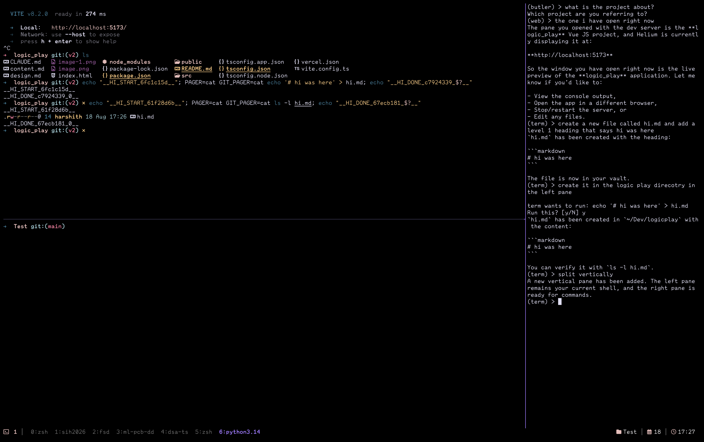

<div align="center">


### A terminal-first AI assistant that lives in a tmux pane next to your shell.

No GUI. No browser tab. Nothing to Alt-Tab to — just a prompt, right where you're already working.


</div>

---



*One real session, no cuts: `butler` explaining what's running, `web` reading a live dev-server URL back, `term` creating a file, confirming a destructive-looking command, and splitting a new pane — all in the same right-hand tmux pane, left pane never touched.*

## Why `hi`

Most AI coding assistants want their own window, their own editor, their own everything. `hi` doesn't. It opens as a 25%-width pane next to whatever you're already doing and stays out of the way until you talk to it.

- **The filesystem is the single source of truth.** No vector DB, no hidden state — anything `hi` remembers is a Markdown file you can open, edit, or delete yourself, stored in your own Obsidian vault.
- **Terminal-first, always.** Instant startup, no GUI, ever — that's a hard constraint, not a launch-day placeholder.
- **Your shell stays yours.** One tmux pane per persona; the assistant runs commands in a pane it never takes away from you.

## Features

| | |
|---|---|
| **5 ways in** | Four dedicated personas (shell + general assistant, macOS control, vault search, web lookup) plus an auto-routing mode that classifies each prompt and picks one for you |
| **Claude-style model tiers** | Every auto-routed turn also picks a haiku/sonnet/opus-equivalent Ollama model sized to the request — pulled on demand if you don't have it yet |
| **Real streaming** | Token-by-token output, not a wall of text after a long wait |
| **Persistent memory** | Notes, per-person context, and full conversation history — grounded automatically before every answer, no vector search required |
| **Strict, cited vault search** | `docs` only ever answers from what's actually written in your notes, and says so plainly when it can't find anything |
| **Real shell execution** | Commands run *visibly* in your own left-hand pane, not hidden in a subprocess — heredocs, pagers, and multi-step chains (`git add` → `commit` → `push`) all handled |
| **Voice input** | Ctrl-V records, transcribes locally with `faster-whisper`, and drops the text in the input line for you to edit before sending |
| **Deep macOS control** | Bluetooth, volume, Wi-Fi, Do Not Disturb, screenshots, clipboard, brightness, lock, app/window management |
| **Dev-flow launcher** | Reopen a saved project's directory, apps, and tmux layout by name — or save your current directory as a new one, hands-free |
| **A daily briefing** | Auto-routing mode opens with your pending tasks, most recently touched note, and most recent project, boiled down into one actionable yes/no suggestion |

## Quick Start

Prerequisites: [`uv`](https://docs.astral.sh/uv/), `tmux`, and [Ollama](https://ollama.com) configured with the models below.

```bash
git clone <this repo>
cd hi
uv tool install --editable .
```

This puts a `hi` shim on `PATH` at `~/.local/bin/hi`, pointing to an isolated venv `uv` manages — `--editable` means edits to this repo's *source* take effect immediately, no reinstall needed. It does **not** auto-sync new *dependencies* added to `pyproject.toml`, though — after pulling a change that adds one, run `uv tool upgrade hi`, or `hi` will fail with `ModuleNotFoundError` for the new package even though `uv run` inside the repo works fine (that uses this repo's own `.venv`, a separate environment). Make sure `~/.local/bin` is on your `PATH` (`uv tool update-shell` will add it if it isn't).

Ctrl-V voice input needs mic access (macOS will prompt the first time) and downloads its `faster-whisper` model on first use.

```bash
cd ~/Projects/whatever
hi
```

opens a new tmux window (or session, if you weren't already in one) split 25/75: your shell on the left, the assistant on the right — auto-routing by default, or add a flag below to force a specific persona.

```text
+------------------------------+----------------------+
|                              |                      |
| your shell, untouched        | (hi) >               |
|                              |                      |
+------------------------------+----------------------+
```

## Personas

| Flag       | Name     | What it's for                                                       | Model                |
| ---------- | -------- | ------------------------------------------------------------------- | -------------------- |
| `--term`   | `term`   | Shell (NLP-to-command in your left pane) + general assistant — persistent memory, people notes, dev-flow launcher | `gpt-oss:120b-cloud` |
| `--butler` | `butler` | macOS control, TODO list — Bluetooth, volume, Wi-Fi, DND, screenshots, clipboard, apps, windows | `gpt-oss:120b-cloud` |
| `--docs`   | `docs`   | Obsidian vault search — cites and summarizes only your own notes    | `gpt-oss:120b-cloud` |
| `--web`    | `web`    | Search-and-summarize over Wikipedia, on a faster model              | `gpt-oss:20b-cloud`  |

```text
(term) > what are the files in this folder
(term) > what are the permissions on the first one
(term) > I want to work on kaapi
(term) > Who do I know?

(butler) > Turn Bluetooth off
(butler) > Lock my Mac
(butler) > Add buy milk to my todo list

(docs) > What does my Docker note say about volumes?
(docs) > Save this: <content> to preferences.md

(web) > What is virtual memory?
```

`term` is the general-purpose default — there used to be a separate `code` persona for memory, notes, and dev flows, which was removed and folded into `term`, so there's one persona for that instead of two with overlapping jobs. It's the only persona with real cross-turn memory (recalls a previous command's output or a loaded note without re-running/re-searching) and the only one grounded in `hi/knowledge/`/`hi/conversations/`.

## Auto-Routing Mode

Running `hi` with no flag starts the right pane as `(hi) >` instead of a fixed persona. Each prompt is classified — which persona fits, and which model tier the request warrants — and routed automatically; the prompt updates to show whichever persona just handled the turn:

```text
(hi) > what are the files in this folder
(term) > how many did you find
```

Every turn is classified independently — it's not "locked in" to one persona for the rest of the session, so a short follow-up with no persona-specific wording can occasionally route somewhere unexpected (a known trade-off of per-turn classification, not a bug). `term`'s own conversation memory is unaffected either way — it picks back up correctly once a later turn routes back to it.

`--butler`/`--docs`/`--web`/`--term` still work exactly as shown above, for when you want to force a specific persona and skip routing/tiering entirely.

Auto-routing mode also opens with a one-line briefing — pending TODO items, the most recently edited vault note, and the most recently opened project, distilled into one actionable suggestion:

```text
Today's Tasks:
1. Buy milk
Most recently edited vault note: hi/conversations/2026-08-18.md
Most recently opened project: hi

Want to check off the buy milk task?
(hi) > yes
```

Answering with a bare `y`/`yes`/`sure`/etc. as the very first input runs the suggested action for real, through the normal routing pipeline — anything else is treated as a normal turn and the suggestion is dropped.

## Keyboard & Commands

| Key / word | Effect |
|---|---|
| `exit` / `quit` | End the assistant process only — the tmux window stays open |
| `clear` / `cls`, **Ctrl-L** | Clear the terminal without restarting the persona |
| **Ctrl-V** | Record from the mic, transcribe with `faster-whisper`, drop the text in the input line for you to review or edit — Enter submits it same as typing |
| **Ctrl-J** *(in `term`)* | Stop waiting on a shell command that's never going to finish (a dev server left running on purpose is the common case), without killing it — the prompt stays usable instead of sitting unresponsive for the full wait window |

## Configuration — `~/.hi/`

`hi`'s own config lives under one fixed home directory, regardless of which project directory you launched it from:

```text
~/.hi/
├── .env             # VAULT_PATH + per-persona + tier model overrides
├── dev_flows.json   # project name -> directory, apps, tmux layout
└── tree_cache.md    # cached `tree -L 4` snapshot of the vault
```

All actual memory — knowledge notes and conversation logs, from every persona — is written into your own Obsidian vault, at the path configured by `VAULT_PATH` in `~/.hi/.env` (defaults to `~/.hi/vault` if unset):

```text
<VAULT_PATH>/hi/
├── knowledge/         # Markdown notes, organized by topic, tagged `hi`
│   └── people/         # one note per person `term` knows about, e.g. Dean_Haidt.md
├── conversations/     # one dated log per day, every persona, tagged `hi`
└── todo.md            # butler's TODO list
```

Every note and conversation log carries Obsidian-compatible YAML frontmatter (`tags: [hi]`), so the vault's own tag search finds them like any other note. `docs` can additionally *read* any note anywhere in the vault (not just `hi/knowledge/`) to answer questions, but only ever *writes* inside `hi/knowledge/` — your own notes are never edited or overwritten.

### Dev Flows

`term` can open a saved project workspace by name:

```text
(term) > I want to work on kaapi
```

configured in `~/.hi/dev_flows.json`:

```json
{
  "kaapi": {
    "directory": "/path/to/kaapi",
    "tmux": { "left": "bench start", "right": "htop" },
    "apps": ["zed", "open ."]
  }
}
```

`term` is also aware of the directory `hi` was launched from (it's the implicit "active project" for anything you don't otherwise scope), and can save it as a new dev flow itself:

```text
(term) > save this directory as a dev flow called kaapi
```

`dev_flows.json` stays a plain file you can hand-edit anytime either way — this just gives `term` a way to add to it too. `term` can also split a new pane in the current workspace for something meant to keep running (a dev server, a log tail), rather than tying up the pane it runs ordinary commands in:

```text
(term) > split a pane and run npm run dev
```

## Architecture

<details>
<summary>File map</summary>

```text
hi/cli.py                  argparse + tmux launcher, dispatches to a persona or router
hi/personas.py              registry: persona name -> agent, on-turn hook, build_agent
hi/repl.py                   generic input loop + auto-routing loop, shared prompt_toolkit setup
hi/router.py                  classifies each router-mode turn into (persona, tier)
hi/models.py                   haiku/sonnet/opus tier -> ChatOllama, pulls on demand
hi/briefing.py                  pre-session tasks/notes/projects -> one suggested action
hi/streaming.py                 streams any agent's response token-by-token
hi/tmux_util.py              shared tmux new-session/new-window helper
hi/config.py                 reads ~/.hi/.env: VAULT_PATH + per-persona + tier models
hi/vault.py                   shared Markdown memory tools, backed by the vault
hi/memory_graph.py            shared grounding graph: select notes -> load -> agent
hi/tree_cache.py               `tree -L 4` snapshot of the vault, for grounding
hi/model_warmup.py             background warm-up + retry around Ollama Cloud's
                                 occasional empty done_reason='load' response
hi/voice.py                     Ctrl-V mic capture + faster-whisper transcription

hi/agents/butler/  (butler.py + todo.py + mac_control.py)          the `butler` persona
hi/agents/docs/    (docs.py + vault_rag.py)                         the `docs` persona
hi/agents/web/     (web.py)                                          the `web` persona
hi/agents/term/    (term.py + shell_pane.py + danger.py +             the `term` persona:
                    dev_flow_tool.py + people.py +                    shell + memory + people +
                    tmux_control.py)                                  dev flows + pane splitting
```

Every persona module exposes both a `model`/`agent` pair built at import time (used by `--flag` launches) and a `build_agent(model)` factory (used by the router to build the same persona bound to a different, tier-selected model) — the direct-flag path is unaffected by the router's dynamic model selection.

</details>

## By the Numbers

| | |
|---|---|
| Personas | 4 dedicated + 1 auto-router |
| Tools across all personas | 39 |
| Python source | 2,366 lines across 31 files |
| Model tiers | 3 (haiku / sonnet / opus) |
| Direct dependencies | 13 |
| Built | July – August 2026 |

*(counted directly from the source tree and tool registries, not estimated)*

## Further Documentation

- [docs/assistants.md](docs/assistants.md) — terminal interface specification
- [CLAUDE.md](CLAUDE.md) — memory system implementation notes
- [docs/TODO.md](docs/TODO.md) — implementation progress
